<!-- ========================================================= -->
<!--        PREMIUM TERMINAL / DEVELOPER HERO BANNER           -->
<!-- ========================================================= -->

<p align="center">
  <picture>
    <source media="(prefers-color-scheme: dark)" srcset="./dark.svg" />
    <source media="(prefers-color-scheme: light)" srcset="./light.svg" />
    
  </picture>
</p>

<div align="center">

<p align="center">
  <a href="https://github.com/jeevanjacob1">
    
  </a>
  <a href="https://linkedin.com/in/jeevanjacob1234">
    
  </a>
  <a href="mailto:jeevanjacob218@gmail.com">
    
  </a>
  <a href="https://instagram.com/_jeev.z">
    
  </a>
  
</p>

<p align="center">
  
</p>

</div>

---

<!-- ========================================================= -->
<!--                       ABOUT ME                            -->
<!-- ========================================================= -->

## 👋 About Me

I am **Jeevan A Jacob**, a Computer Science and Engineering student at **Amrita University** dedicated to building resilient full-stack web applications, exploring Generative AI architectures, and turning technical concepts into polished products.

- 🤖 **Artificial Intelligence & Machine Learning:** LLMs, Generative AI pipelines, AI agents, Model Context Protocol (MCP).
- 🌐 **Full-Stack Engineering:** High-performance web applications using Next.js, React, Node.js, and FastAPI.
- 🎨 **Modern Cinematic UI/UX:** Interactive interfaces, micro-interactions, responsive design, and glassmorphism.
- ⚡ **Real-Time Systems:** WebSockets, state synchronization, secure auth (JWT/OAuth), and microservice patterns.
- ☁️ **Cloud & Deployment:** Docker, AWS, GCP, CI/CD with GitHub Actions.

> **Engineering Philosophy:** `Build → Break → Learn → Improve → Repeat`

---

<!-- ========================================================= -->
<!--                 WHAT I'M WORKING ON                       -->
<!-- ========================================================= -->

## 🚀 Current Engineering Focus

```text
┌────────────────────────────────────────────────────────────────────────┐
│ SYSTEM.TELEMETRY // ACTIVE WORKSPACE                                    │
├────────────────────────────────────────────────────────────────────────┤
│ 🤖 Generative AI & Autonomous Agent Architectures                     │
│ 🔌 Model Context Protocol (MCP) tooling & custom server integrations   │
│ ⚛️ Modern full-stack development with Next.js (App Router) & React 19   │
│ ⚡ Asynchronous backend services with FastAPI, Node.js & WebSockets     │
│ ☁️ Cloud infrastructure, automated CI/CD pipelines & containerization │
│ 🏗️ Production-grade database design with PostgreSQL, MySQL & SQLite    │
└────────────────────────────────────────────────────────────────────────┘
```

---

<!-- ========================================================= -->
<!--                      TECH STACK                           -->
<!-- ========================================================= -->

## 🧰 Tech Stack

### Languages & Fundamentals
<p>
  
</p>

### Frontend Engineering
<p>
  
</p>

### Backend & Real-Time APIs
<p>
  
</p>

### Databases & Storage
<p>
  
</p>

### Cloud, DevOps & Developer Tooling
<p>
  
</p>

---

<!-- ========================================================= -->
<!--                  FEATURED PROJECTS                        -->
<!-- ========================================================= -->

## 🏗️ Featured Projects

### 🏥 [DischargeAI](https://github.com/jeevanjacob1)
> **AI-Powered Hospital Discharge & Aftercare Clinical Platform**

An intelligent platform streamlining clinical discharge workflows, medication adherence, and post-discharge recovery monitoring through generative AI summaries and patient guidance.

`AI/ML` `Full Stack` `Healthcare` `Next.js` `FastAPI`

---

### ⏳ [QueueEase](https://github.com/jeevanjacob1)
> **Real-Time Queue Management & Digital Ticketing Platform**

A full-stack queue management platform designed for clinics and service centers featuring live queue progression, digital ticketing, role-based access control, and low-latency WebSocket synchronization.

`Node.js` `Express.js` `SQLite` `WebSockets` `JWT` `REST API`

---

### 💊 [Pharmacy Management System](https://github.com/jeevanjacob1)
> **Inventory, Stock Forecasting & Sales Platform**

A production-focused pharmaceutical inventory management system supporting multi-tier medicine tracking, automated stock alerts, purchase billing, and sales analytics.

`Python` `Flask` `MySQL` `Jinja2` `Bootstrap`

---

### 🏕️ [TrailForge](https://github.com/jeevanjacob1)
> **Cinematic Adventure Gear & E-Commerce Web Experience**

An e-commerce experience designed with high visual fidelity, fluid micro-interactions, responsive product grids, and streamlined cart state management.

`React` `Full Stack` `UI/UX` `E-Commerce` `Tailwind CSS`

---

### ✍️ [TruthText](https://github.com/jeevanjacob1)
> **Modern Digital Publishing & Content Architecture**

A full-stack editorial and content publishing platform engineered for clean typography, seamless publishing workflows, and responsive cross-device reading experiences.

`Web Development` `Full Stack` `UI/UX` `JavaScript`

---

### 🌐 [Developer Portfolio](https://github.com/jeevanjacob1)
> **Interactive Technical Showcase & Identity Matrix**

A personal developer portfolio spotlighting software engineering projects, technical stack benchmarks, and interactive visual aesthetics.

`React` `Modern Web` `Responsive UI` `Animations`

---

<!-- ========================================================= -->
<!--                  GITHUB ANALYTICS                         -->
<!-- ========================================================= -->

## 📊 GitHub Analytics

<div align="center">

<a href="https://github.com/jeevanjacob1">
  
</a>
<a href="https://github.com/jeevanjacob1">
  
</a>

<br><br>


<br><br>


</div>

---

<!-- ========================================================= -->
<!--               GITHUB CONTRIBUTION SNAKE                   -->
<!-- ========================================================= -->

<h2 align="center">📊 GitHub Contributions</h2>

<p align="center">
  <picture>
    <source
      media="(prefers-color-scheme: dark)"
      srcset="https://raw.githubusercontent.com/jeevanjacob1/jeevanjacob1/output/github-contribution-grid-snake-dark.svg"
    />
    <source
      media="(prefers-color-scheme: light)"
      srcset="https://raw.githubusercontent.com/jeevanjacob1/jeevanjacob1/output/github-contribution-grid-snake.svg"
    />
    
  </picture>
</p>

---

<!-- ========================================================= -->
<!--              CERTIFICATIONS & LEARNING                    -->
<!-- ========================================================= -->

## 📜 Certifications & Learning

- 🔹 **IBM AI Fundamentals**
- 🔹 **Machine Learning Specialization**
- 🔹 **Java Programming Foundations**
- 🔹 **Git & GitHub Professional Workflows**
- 🔹 **Claude Code 101 Certification**
- 🔹 **Quantum Leap Engineering Bootcamp**
- 🔹 **Nitrostack MCP Building Certificate**

---

<!-- ========================================================= -->
<!--                    CONNECT WITH ME                        -->
<!-- ========================================================= -->

## 🤝 Connect & Collaborate

I am always keen to collaborate on **Generative AI systems**, **Full-Stack SaaS applications**, **Open Source tools**, and **Hackathon challenges**.

<div align="center">

<p align="center">
  <a href="mailto:jeevanjacob218@gmail.com">
    
  </a>
  &nbsp;&nbsp;
  <a href="https://linkedin.com/in/jeevanjacob1234">
    
  </a>
  &nbsp;&nbsp;
  <a href="https://github.com/jeevanjacob1">
    
  </a>
</p>

<br>

> *"Don't just learn technology. Build something meaningful with it."*

<br>

⭐ **Thank you for visiting my GitHub Profile!**

</div>

<br>


